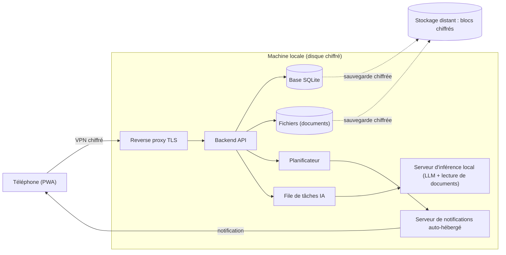

# Architecture technique (phase E) — brouillon complet

Statut : proposition complète, à valider. Les choix sont **recommandés avec leurs alternatives** ; les valeurs chiffrées sont des objectifs de départ. Les noms de modèles et d'outils évoluent vite : ils sont cités comme points de départ à **tester sur des documents fictifs**, pas comme des choix figés.

## 1. Exigences qui guident l'architecture

Issues du cadrage et des décisions :

- **Aucune donnée en clair sur un serveur non maîtrisé.** Les données ne résident que sur des machines de l'utilisateur ; tout ce qui sort est chiffré avant de sortir.
- **IA locale**, sans appel à une API externe.
- **Accès depuis smartphone** (PWA, Android de plusieurs générations), avec chiffrement et notifications urgentes.
- **L'IA propose, l'humain décide** ; les calculs sont faits par du code.
- **Maintenance minimale** et fonctionnement fiable, avec un mode dégradé si la machine tombe.
- **Réutilisable** : tout ce qui est propre à un utilisateur vit dans la configuration et les données, jamais dans le code du dépôt.
- **Matériel cible modeste** : un PC grand public avec un GPU de 8 à 12 Go de mémoire vidéo.

## 2. Vue d'ensemble

## 3. Composants et choix

| Composant | Choix recommandé pour la V1 | Alternatives | Raison |
| --- | --- | --- | --- |
| Machine | PC allumé en permanence, Linux de préférence, services en conteneurs, disque chiffré, onduleur | Mini-PC pour la base et les notifications, PC puissant à la demande pour l'IA | Isolation des services, redémarrage automatique, mises à jour maîtrisées |
| Base de données | **SQLite** (mode WAL), migrations versionnées | PostgreSQL si plusieurs écritures simultanées intenses | Un seul fichier, sauvegarde simple, largement suffisant pour un foyer |
| Fichiers | Dossier dédié hors dépôt, nom = empreinte (hash) du contenu | Stockage objet local | Détection des doublons et de la corruption |
| Backend | API REST locale ; **Python** (FastAPI) recommandé | Tout langage avec un bon écosystème de tâches planifiées | Écosystème riche pour l'IA et la lecture de documents |
| Planificateur | Intégré au backend, appelant le moteur de règles (`03-regles-de-calcul.md`) | cron système | Une seule source de vérité pour les échéances |
| Interface | **PWA** légère : consultation, saisie texte, photo, résumé du jour, validations | Application native si les limites de la PWA gênent | Un seul code pour tous les téléphones |
| Serveur d'inférence | Serveur local compatible (llama.cpp ou équivalent), sortie contrainte par un **schéma JSON** | Autres serveurs locaux | La sortie structurée évite les réponses inexploitables |
| Notifications | Serveur **ntfy auto-hébergé**, priorité 3 = normale, priorité 5 = urgente | Web Push de la PWA, avec contenu minimal | Voir section 6 |
| Accès distant | **WireGuard** : en étoile via un relais que l'utilisateur administre, ou direct s'il n'en a pas | Headscale auto-hébergé | Voir section 5 |
| Sauvegardes | **restic** (chiffrement côté client) vers un stockage distant | borg, ou tout outil chiffrant côté client | Le prestataire ne voit que des blocs chiffrés |

## 4. IA locale

### Rôle et limites

L'IA sert à **extraire, rédiger, répondre et expliquer**. Elle ne calcule aucune date et n'écrit jamais directement dans la base : elle produit des **propositions** que l'utilisateur valide.

### Modèles : points de départ à tester

- **Extraction et dialogue** : modèles de 8 à 14 milliards de paramètres, quantifiés en 4 bits. Les familles citées par les comparatifs récents pour 12 Go : Qwen 3 (14B), Gemma 3 (12B), Phi-4 (14B), Llama 3.1 (8B). Un modèle de 14B occupe environ 9 Go ; il reste alors peu de place pour le contexte.
- **Lecture de documents** : petits modèles spécialisés de 1 à 2 milliards de paramètres (familles PaddleOCR-VL, GLM-OCR, LightOnOCR) ou OCR classique, environ 2 Go.
- Aucun comparatif consulté ne couvre l'extraction JSON en français sur des documents domestiques : **le choix se fait par test** sur un jeu de documents fictifs, sans jamais utiliser de vraies données pour l'évaluation hors de la machine locale.

### Contrainte de mémoire vidéo

Un seul modèle est chargé à la fois. Le backend met les tâches IA dans une **file** et exécute : lecture du document, puis extraction, puis déchargement. Les tâches IA ne bloquent jamais les rappels, qui ne dépendent pas de l'IA.

### Pipeline de lecture d'un document

1. **Routage** : un PDF avec texte numérique n'a pas besoin d'OCR ; une photo ou un scan passe par la lecture de document.
2. **Lecture** : OCR classique ou petit modèle de lecture.
3. **Extraction** : le LLM remplit un schéma JSON (type de document, dates, montants, acteur, etc.).
4. **Règles de validation** (code) : dates plausibles, montants cohérents, champs obligatoires présents.
5. **Proposition** : l'utilisateur voit l'image à côté des valeurs extraites et valide ou corrige.

Principe repris des comparatifs consultés : **le modèle propose des candidats, les règles et l'humain décident**. Les modèles de lecture peuvent produire des valeurs plausibles mais non lues : aucune échéance ne repose sur une donnée non validée.

### Sécurité propre à l'IA

- **Le contenu d'un document n'est jamais une instruction.** Le texte d'une photo, d'un PDF ou d'un mail ne peut déclencher aucune action (protection contre l'injection de consignes dans les documents).
- Pour répondre aux questions, l'IA appelle des **fonctions de lecture prédéfinies** (échéances à venir, historique d'une ressource, etc.) ; elle n'écrit pas de requête libre dans la base.
- Toute écriture passe par une **proposition validée** par un utilisateur.
- Le service d'IA n'a **aucun accès sortant à Internet** (règle de pare-feu) ; ses mises à jour se font de façon contrôlée.

## 5. Accès distant

| Option | Avantages | Limites | Verdict |
| --- | --- | --- | --- |
| **WireGuard en étoile via un relais administré** (VM minimale sur un serveur en ligne que l'utilisateur administre) | Aucun port ouvert chez soi, adresse fixe, fonctionne même sans adresse publique à domicile, VPN permanent possible sur Android | Un serveur de plus à sécuriser et à mettre à jour ; le relais connaît les métadonnées de connexion | **Recommandé si l'utilisateur dispose déjà d'un tel serveur** |
| **WireGuard direct** | Aucun intermédiaire, très léger | Nécessite une adresse publique joignable et un port ouvert chez soi | Recommandé sinon |
| Headscale auto-hébergé (plan de contrôle de type Tailscale) | Enregistrement des appareils simplifié, règles d'accès, trafic direct chiffré | Un serveur de plus à exploiter et à sauvegarder ; pas d'interface officielle | À envisager si le nombre d'appareils augmente |
| Service cloud de VPN maillé | Très simple | Le plan de contrôle est chez un tiers, ce qui contredit la règle de maîtrise | **Écarté** |
| Application exposée sur Internet derrière une authentification | Aucun logiciel sur le téléphone | Surface d'attaque large, données sensibles exposées | **Écarté pour la V1** |

### Topologie en étoile via un relais administré

Le téléphone et la machine locale se connectent **tous deux** à une petite VM de relais ; la machine locale n'ouvre aucun port sur Internet.

- **Le relais ne doit rien voir en clair.** Un relais WireGuard en étoile route les paquets entre les deux appareils et pourrait voir le contenu non chiffré qui les traverse. C'est pourquoi le **TLS se termine sur la machine locale** (jamais sur le relais) : le relais ne voit que du trafic TLS chiffré de bout en bout.
- **Aucune donnée, aucun service applicatif** dans la VM de relais : uniquement WireGuard.
- **VM dédiée et minimale**, isolée des autres VM du serveur ; seul le port du VPN est ouvert sur Internet.
- L'**interface d'administration de l'hyperviseur** n'est jamais exposée sur Internet : accessible seulement par le VPN ; second facteur activé ; mises à jour régulières.
- **Limite à connaître** : le serveur physique appartient à un hébergeur. C'est acceptable pour un relais qui ne voit que du trafic chiffré et pour des sauvegardes chiffrées côté client, **pas** pour héberger l'application, la base ou l'IA, qui seraient lisibles en mémoire.
- **Sans serveur en ligne** : WireGuard direct, avec un port ouvert chez soi et une adresse publique joignable ; sinon louer un petit relais selon les mêmes règles.
- Le **nom de domaine** sert à nommer la machine et à obtenir des certificats ; l'application n'est pas exposée publiquement.
- Sur le téléphone : VPN permanent activé, application PWA installée.

## 6. Notifications

- **Serveur ntfy auto-hébergé**, joignable uniquement dans le VPN. L'application Android se connecte à **ton** serveur ; d'après la documentation, Firebase n'est utilisé que pour le serveur public du projet et seulement dans la version Google Play, pas dans la version F-Droid.
- **Livraison instantanée** : l'application garde une connexion permanente (service au premier plan, avec une notification persistante). Sans elle, certaines notifications peuvent arriver avec des minutes ou des heures de retard.
- **Priorités** : 1 à 5 ; priorité 3 (normale) et priorité 5 (urgente, fenêtre contextuelle). Chaque priorité a son canal Android : on peut régler le son et le contournement du mode « Ne pas déranger » pour l'urgence.
- Correspondance avec les règles : normale = résumé du jour et notification groupée ; urgente = priorité 5, répétée jusqu'à accusé.
- **Web Push de la PWA** : option secondaire. Le contenu est chiffré, mais le routage passe par les services du navigateur ; on n'y envoie qu'un message minimal (« nouvelle alerte »), le détail se charge ensuite depuis le serveur via le VPN.
- Le contenu d'une notification reste **sobre** : pas de montant, pas de nom de contrat.

## 7. Sécurité et confidentialité

| Sujet | Mesure |
| --- | --- |
| Au repos | Chiffrement complet du disque ; sauvegardes chiffrées côté client |
| En transit | Tunnel WireGuard, puis TLS interne |
| Authentification | Compte par utilisateur, mot de passe fort et second facteur (code temporaire ou clé d'accès) ; session de durée limitée |
| Autorisations | Tout est commun dans un espace ; un utilisateur n'accède qu'aux espaces dont il est membre |
| Secrets | Dans un gestionnaire de mots de passe ou des variables d'environnement ; jamais dans le dépôt |
| Journal | Journal d'accès et d'actions (qui a validé quoi) |
| Dépôt | Code et configuration générique seulement ; dossiers de données exclus par `.gitignore` |
| Jeux de test | Données **fictives** uniquement dans les tests et le dépôt |

## 8. Sauvegardes et reprise

- **Règle 3-2-1** : la machine, une copie locale sur un autre disque, une copie distante.
- **Contenu** : base (copie cohérente), fichiers, configuration, scripts de remise en place.
- **Fréquence** : quotidienne, incrémentale ; rétention à définir (par exemple 7 quotidiennes, 4 hebdomadaires, 12 mensuelles).
- **Chiffrement côté client** : le stockage distant ne reçoit que des blocs chiffrés. C'est ce qui rend l'usage d'un prestataire d'hébergement compatible avec la règle de maîtrise des données.
- **Clé et mot de passe du dépôt** : un mot de passe propre au dépôt, conservé dans un gestionnaire de mots de passe **et** en copie hors ligne séparée de la machine (support chiffré rangé ailleurs), avec une copie des fichiers de configuration et de clés du dépôt de sauvegarde. Sans eux, la restauration est impossible.
- **Tests de restauration** : avant toute donnée réelle, puis au moins une fois par an sur une machine vierge ; chaque trimestre, vérifier que de nouvelles sauvegardes arrivent bien.
- **Supervision** : un « signal de vie » à chaque sauvegarde réussie ; l'absence de signal déclenche une notification (via le serveur de notifications auto-hébergé, pour ne dépendre d'aucun service tiers).

## 9. Fiabilité et mode dégradé

| Panne | Conséquence | Parade |
| --- | --- | --- |
| Machine arrêtée | Plus de rappels ni d'accès | Onduleur, redémarrage automatique, surveillance de santé des disques et de l'espace libre |
| Machine détruite | Perte potentielle de données | Restauration depuis la sauvegarde sur un autre PC ; procédure écrite et testée |
| Accès distant coupé | Pas d'accès depuis le téléphone | La PWA affiche le **dernier état en cache** en lecture seule et met les saisies en attente |
| Service d'IA indisponible | Plus d'extraction ni de questions | Rappels et résumé du jour **continuent**, car ils ne dépendent pas de l'IA ; saisie manuelle possible |
| Notification manquée | Échéance oubliée | Relances par paliers ; échéance en retard visible dans le résumé du jour |

Option peu coûteuse : un **export hebdomadaire chiffré** des échéances à venir, consultable sans le serveur.

## 10. Maintenance

- Services épinglés par version, mises à jour **mensuelles** et testées sur le jeu de données fictif avant la machine réelle.
- Objectif : **une heure par mois** de maintenance au plus (valeur proposée).
- Procédure de reprise et procédure de mise à jour écrites dans le dépôt, sans donnée personnelle.

## 11. Plan d'implémentation de la V1 (phase F)

| Jalon | Contenu | Critère d'acceptation |
| --- | --- | --- |
| 0. Socle | Machine, disque chiffré, conteneurs, VPN, sauvegardes chiffrées | Une restauration complète réussie, avant toute donnée réelle |
| 1. Base et API | Schéma issu du modèle de données, migrations, API de lecture et d'écriture, jeu de données fictif | Tous les types et relations manipulables par l'API |
| 2. Moteur d'échéances | Règles de `03-regles-de-calcul.md`, tests automatiques | Tous les cas des règles couverts par des tests |
| 3. PWA | Consultation, saisie texte, résumé du jour, validation des propositions | Utilisable depuis deux téléphones d'anciennes et de récentes générations |
| 4. Notifications | Serveur de notifications, paliers, urgence, accusés | Une échéance urgente de test déclenche la bonne notification, répétée jusqu'à accusé |
| 5. Documents | Photo, lecture, extraction, validation | Taux de documents de test acceptés sans correction mesuré |
| 6. Questions | Fonctions de lecture exposées à l'IA, questions en langage naturel | Réponses justes sur un jeu de questions de test |
| 7. Regroupements | Propositions de passages communs | Propositions justes sur des cas de test |

Ordre voulu : les jalons 0 à 4 donnent déjà un système qui **rappelle**, ce qui est l'attente première, avant que l'IA n'intervienne.

## 12. Critères de réussite de la V1 (phase G)

Valeurs proposées, à ajuster :

- **Aucune échéance manquée** sur trois mois d'usage réel.
- Saisie d'un document en **moins d'une minute**, validation comprise.
- Maintenance de **moins d'une heure par mois**.
- Restauration complète en **moins de deux heures**.
- Au moins **80 %** des extractions acceptées sans correction, mesuré sur les documents réellement ajoutés.
- Aucune donnée en clair hors des machines de l'utilisateur (vérification périodique).

## 13. Risques

| Risque | Parade |
| --- | --- |
| Extraction erronée d'une date ou d'un montant | Validation humaine, règles de cohérence, aucune échéance sans donnée validée |
| Injection de consignes via un document | Le contenu d'un document n'est jamais une instruction ; l'IA n'écrit pas dans la base |
| Perte de la clé de sauvegarde | Copie hors ligne séparée, test de restauration |
| Mémoire vidéo insuffisante | Un modèle à la fois, quantification, modèles plus petits |
| Complexité de maintenance | Peu de composants, versions épinglées, objectif d'une heure par mois |
| Matériel qui vieillit | Procédure de restauration sur un autre PC ; possibilité de changer de GPU sans changer le logiciel |
| Notifications retardées par l'économie d'énergie du téléphone | Livraison instantanée, exclusion de l'application de l'optimisation de batterie, relances par paliers |

## 14. Décisions

Les choix 1 à 4 ont été laissés au jugement de Claude par l'utilisateur : ils sont **retenus**. Le choix 5 reste à trancher par test.

| N° | Décision | Statut |
| --- | --- | --- |
| 1 | **SQLite** plutôt que PostgreSQL pour la V1 | Retenu |
| 2 | **WireGuard en étoile via un relais administré** (TLS terminé sur la machine locale) quand l'utilisateur dispose d'un serveur en ligne ; WireGuard direct sinon | Retenu, précisé |
| 3 | **ntfy auto-hébergé** pour les notifications, Web Push seulement en secours | Retenu |
| 4 | **Une seule machine** pour tout en V1 ; IA sur une machine dédiée si le besoin apparaît | Retenu |
| 5 | **Modèles** : à choisir par test sur des documents fictifs avant tout usage réel | En attente du protocole de test |

## Sources consultées

Sources non officielles pour la plupart, à vérifier avant décision :

- [Best LLM for 12GB VRAM](https://localaimaster.com/vram/best-llm-12gb-vram) : tailles et mémoire des modèles de 8 à 14 milliards de paramètres.
- [Local vision-language models for OCR](https://wz-it.com/en/blog/local-vlm-ocr-models/) : modèles de lecture de documents, risques de valeurs non lues, principe « le modèle propose, les règles décident ».
- [What is Headscale?](https://wz-it.com/en/knowledge/remote-access/what-is-headscale/) : plan de contrôle auto-hébergé et compromis face à WireGuard seul.
- [ntfy : application Android](https://docs.ntfy.sh/subscribe/phone) : livraison instantanée, Firebase, priorités.
- [Restore tests, best practices (forum restic)](https://forum.restic.net/t/restore-tests-best-practices-lesson-learned/7351) : tests de restauration, gestion du mot de passe du dépôt.
